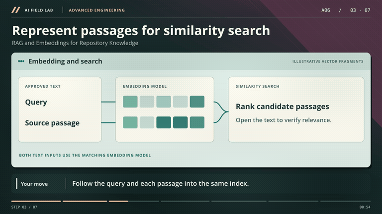

# Path de IA · Avanzado

Configura agentes en GCP, limita las herramientas que pueden usar y evalúa sus resultados con casos reproducibles. Practica recuperación de fuentes y revisión de evidencia.

Cada episodio tiene narración y subtítulos en inglés. El MP4 incluye capítulos para volver a un paso. [Descargar el episodio de muestra A06](https://github.com/Finithe-Phoenix/Path-Level-3-IA/raw/refs/heads/main/videos/A06.mp4).

[](https://github.com/Finithe-Phoenix/Path-Level-3-IA/raw/refs/heads/main/videos/A06.mp4)

| Episodio | Demostración | Duración | Archivos |
|---|---|---:|---|
| A01 | Start an Agent Session in GCP | 3:21 | [MP4](https://github.com/Finithe-Phoenix/Path-Level-3-IA/raw/refs/heads/main/videos/A01.mp4) · [SRT](subtitles/A01.en.srt) |
| A02 | Version Instructions and Skills Across Tools | 3:22 | [MP4](https://github.com/Finithe-Phoenix/Path-Level-3-IA/raw/refs/heads/main/videos/A02.mp4) · [SRT](subtitles/A02.en.srt) |
| A03 | Run a Multi-File Change in Stages | 3:16 | [MP4](https://github.com/Finithe-Phoenix/Path-Level-3-IA/raw/refs/heads/main/videos/A03.mp4) · [SRT](subtitles/A03.en.srt) |
| A04 | What Is MCP? Connect One Scoped Tool | 2:50 | [MP4](https://github.com/Finithe-Phoenix/Path-Level-3-IA/raw/refs/heads/main/videos/A04.mp4) · [SRT](subtitles/A04.en.srt) |
| A05 | Design a Workflow with Deterministic Checks | 2:51 | [MP4](https://github.com/Finithe-Phoenix/Path-Level-3-IA/raw/refs/heads/main/videos/A05.mp4) · [SRT](subtitles/A05.en.srt) |
| A06 | RAG and Embeddings for Repository Knowledge | 2:49 | [MP4](https://github.com/Finithe-Phoenix/Path-Level-3-IA/raw/refs/heads/main/videos/A06.mp4) · [SRT](subtitles/A06.en.srt) |
| A07 | Evaluate Models and Agents on the Same Task | 2:53 | [MP4](https://github.com/Finithe-Phoenix/Path-Level-3-IA/raw/refs/heads/main/videos/A07.mp4) · [SRT](subtitles/A07.en.srt) |

## Reconstruir un episodio en GCP

En el workspace remoto, abre la raíz del repositorio. La producción utiliza Linux, Node.js 24, Python 3.12, FFmpeg y DejaVu Sans. La pista de voz, los subtítulos y los tiempos ya están en Git.

```bash
npm ci --prefix engine
python3 studio.py list
python3 studio.py render A01
python3 studio.py verify A01 --decode
```

El MP4 se escribe en `videos/A01.mp4`. Para renderizar el path completo, usa `python3 studio.py render all`. Para generar el proyecto HTML editable y su vista previa, ejecuta `python3 studio.py project A01` y abre `build/A01/preview.html`. Las instrucciones de HyperFrames y Remotion están en [engine/README.md](engine/README.md).

## Cambiar lo que se explica o cómo suena

Edita el guion, las acciones y los resultados de pantalla en [lessons/episodes.json](lessons/episodes.json). Cada episodio enlaza sus fuentes técnicas. El estilo, el ritmo y la mezcla de voces están en [voice/profile.json](voice/profile.json). Si cambias el texto hablado o el orden de las escenas, regenera la voz antes del render.

```bash
python3.12 -m venv .venv
source .venv/bin/activate
python -m pip install -r voice/requirements.txt
python voice/assets.py
python studio.py voice A01
python studio.py render A01
python studio.py verify A01 --decode
```

Para cambiar solo el ritmo, usa la toma original guardada en `takes/`. Por ejemplo, ejecuta `python3 studio.py pace A01 --target-wpm 142` y vuelve a renderizar. Este ajuste conserva el tono y recalcula escenas y subtítulos. La síntesis de voz descarga dos archivos de modelo con hashes fijados y los reutiliza. Las pistas AAC ya publicadas permiten editar la animación y volver a exportar sin sintetizar voz. [Detalles de narración](voice/README.md).

## Versionar la siguiente edición

Crea una rama para el cambio y conserva el ID de cada episodio. Tras revisar el video, ejecuta `python3 studio.py manifest` para renovar el inventario y `python3 studio.py verify all --release` para cotejar los archivos. Si el episodio editado aparece en la vista previa del README, regenera ese fragmento con `python3 preview.py`. Incluye las fuentes y los archivos generados en el mismo PR. La guía de trabajo está en [AGENTS.md](AGENTS.md).

Las pantallas y los datos del curso son simulaciones didácticas. Los PR del ejemplo los revisa una persona mediante `gh` en el terminal autorizado. Claude Code y OpenCode se ejecutan dentro del workspace de GCP.

Puedes consultar los [materiales de producción de la edición 1](archive/v1/) y los [videos originales](https://github.com/Finithe-Phoenix/Path-Level-3-IA/releases/tag/v1.0.0).
