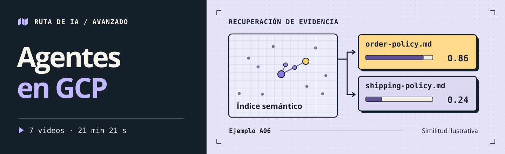

# Avanzado · Agentes en el workspace de GCP

Trabaja con Claude Code y OpenCode dentro del workspace de GCP. La ruta empieza por verificar qué sesión y qué permisos tienes, y termina con dos agentes resolviendo la misma tarea bajo criterios que un revisor puede comprobar.

**7 episodios · 21:21 en total.** Narración y subtítulos en inglés. Cada MP4 incluye capítulos para repetir un paso.

[Descargar el primer episodio (A01)](https://github.com/Finithe-Phoenix/Path-Level-3-IA/raw/videos-v2.0.0/videos/A01.mp4) · [Editar o reconstruir los videos](PRODUCCION.md)

## Temario

Selecciona el título para descargar el video. Puedes activar los subtítulos en tu reproductor o descargar el archivo SRT de cada episodio.

| Episodio | Qué harás en pantalla |
| --- | --- |
| **A01** · [Start an Agent Session in GCP](https://github.com/Finithe-Phoenix/Path-Level-3-IA/raw/videos-v2.0.0/videos/A01.mp4) 3:21 · [SRT](https://github.com/Finithe-Phoenix/Path-Level-3-IA/raw/videos-v2.0.0/subtitles/A01.en.srt) | Verifica el directorio, el cliente, el modelo y los permisos. Conserva el estado de partida de la sesión. |
| **A02** · [Version Instructions and Skills Across Tools](https://github.com/Finithe-Phoenix/Path-Level-3-IA/raw/videos-v2.0.0/videos/A02.mp4) 3:22 · [SRT](https://github.com/Finithe-Phoenix/Path-Level-3-IA/raw/videos-v2.0.0/subtitles/A02.en.srt) | Versiona una convención y una skill. Comprueba dónde las descubre cada cliente y cuándo se activa la skill. |
| **A03** · [Run a Multi-File Change in Stages](https://github.com/Finithe-Phoenix/Path-Level-3-IA/raw/videos-v2.0.0/videos/A03.mp4) 3:16 · [SRT](https://github.com/Finithe-Phoenix/Path-Level-3-IA/raw/videos-v2.0.0/subtitles/A03.en.srt) | Divide una refactorización en etapas y compara pruebas y archivos modificados después de cada una. |
| **A04** · [What Is MCP? Connect One Scoped Tool](https://github.com/Finithe-Phoenix/Path-Level-3-IA/raw/videos-v2.0.0/videos/A04.mp4) 2:50 · [SRT](https://github.com/Finithe-Phoenix/Path-Level-3-IA/raw/videos-v2.0.0/subtitles/A04.en.srt) | Sigue una consulta MCP desde el cliente hasta la lectura de un issue. Inspecciona el argumento y el permiso utilizado. |
| **A05** · [Design a Workflow with Deterministic Checks](https://github.com/Finithe-Phoenix/Path-Level-3-IA/raw/videos-v2.0.0/videos/A05.mp4) 2:51 · [SRT](https://github.com/Finithe-Phoenix/Path-Level-3-IA/raw/videos-v2.0.0/subtitles/A05.en.srt) | Define qué prueba debe fallar antes del arreglo, cuál debe pasar después y cuándo entregar el cambio al revisor. |
| **A06** · [RAG and Embeddings for Repository Knowledge](https://github.com/Finithe-Phoenix/Path-Level-3-IA/raw/videos-v2.0.0/videos/A06.mp4) 2:49 · [SRT](https://github.com/Finithe-Phoenix/Path-Level-3-IA/raw/videos-v2.0.0/subtitles/A06.en.srt) | Recupera pasajes del repositorio mediante embeddings y comprueba qué archivo y revisión sustentan la respuesta. |
| **A07** · [Evaluate Models and Agents on the Same Task](https://github.com/Finithe-Phoenix/Path-Level-3-IA/raw/videos-v2.0.0/videos/A07.mp4) 2:53 · [SRT](https://github.com/Finithe-Phoenix/Path-Level-3-IA/raw/videos-v2.0.0/subtitles/A07.en.srt) | Ejecuta la misma tarea desde el mismo commit y compara corrección, alcance del diff y esfuerzo de revisión. |

Ver un fragmento animado de A06

## Fuentes editables

Para preparar una nueva edición, empieza por el guion y las referencias técnicas de cada escena. El repositorio también guarda los dibujos, la toma original de voz, el audio final y sus marcas de tiempo. [Guiones y referencias](lessons/episodes.json) · [Guía de producción](PRODUCCION.md) · [Guía para agentes](AGENTS.md) · [Descargar las fuentes de v2.0.0 en ZIP](https://github.com/Finithe-Phoenix/Path-Level-3-IA/archive/refs/tags/v2.0.0.zip).

## Otras rutas

[Básico](https://github.com/Finithe-Phoenix/Path-Level-1-IA) · [Medio](https://github.com/Finithe-Phoenix/Path-Level-2-IA) · [Managers](https://github.com/Finithe-Phoenix/Path-Level-Managers-IA)
